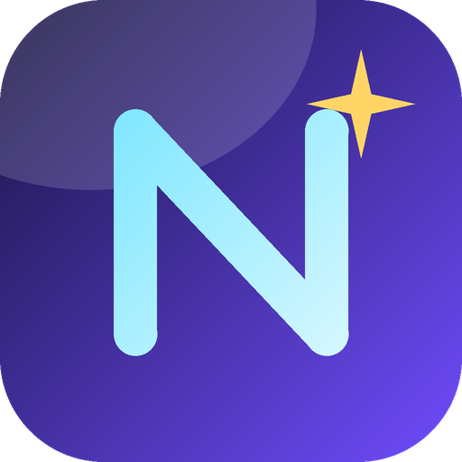

<p align="center">
  
</p>

# Notus

**Приватный офлайн-чат для языковых моделей GGUF — создан специально для старого железа.**

Работает на процессорах **без поддержки AVX2** (AMD FX, Sandy/Ivy Bridge…) и на **видеокартах различных производителей** (NVIDIA, AMD, Intel), на которых Ollama и LM Studio отказываются даже запускаться благодаря переходу на универсальный бэкенд Vulkan.

Notus представляет собой графический интерфейс на PyQt6 для `llama-server` из проекта [llama.cpp](https://github.com). Встроенные сборки компилируются через CI с поддержкой **Vulkan** и инструкций процессора **только уровня AVX1** (для Windows и Linux).

## Возможности

- **Любые модели GGUF:** Добавляйте файлы через поиск, сканируйте папки или просто перетаскивайте их мышкой (Drag & Drop). Сами файлы моделей остаются там, где они лежат.
- **Переключение в один клик:** Быстрая смена моделей и функция **выгрузки** из памяти для мгновенного освобождения RAM и VRAM (а также настраиваемая автовыгрузка при простое).
- **Помодельные настройки:** Контекст, максимальное число новых токенов, параметры генерации (temperature, top-p, top-k, min-p, repeat penalty), seed, системный промпт, количество слоёв на GPU, потоки, размер батчей, Flash Attention, тип KV-кэша, mmap / mlock, шаблоны чата и дополнительные аргументы для llama-server.
- **Планировщик памяти:** Наглядные индикаторы VRAM / RAM и *автоматический расчет слоёв для GPU*. Программа переносит на видеокарту ровно столько слоёв, сколько помещается в свободную VRAM, оставляя остальное в оперативной памяти. Благодаря `mmap` операционная система сама подкачивает невлезающие данные с SSD. Если при загрузке в Vulkan закончится память, Notus автоматически снизит число слоёв и повторит попытку.
- **Пресеты:** Сбалансированный · Мало VRAM (4 ГБ) · Только CPU · Максимум GPU · Большая модель (стриминг с SSD).
- **Потоковый чат:** Поддержка разметки Markdown, история переписки, остановка и регенерация ответов, вывод скорости генерации (токенов в секунду).
- **Интерфейс:** Тёмная и светлая темы, выбор акцентных цветов, локализация на английский и русский языки.
- **Полная приватность:** Никакой телеметрии. Серверная часть слушает исключительно адрес `127.0.0.1`.

## Скачать (Downloads)

При каждом пуше в ветку `main` система GitHub Actions автоматически собирает инсталляторы и прикрепляет их к релизу формата `v<версия>`:

| ОС | Файл | Примечания |
|---|---|---|
| **Windows 10/11 x64** | `Notus-Setup-<ver>.exe` | Локальный установщик для пользователя. Создаёт ярлыки на Рабочем столе и в меню «Пуск». Компоненты Vulkan runtime и Visual C++ уже встроены в папку приложения. |
| **Linux x86_64** | `Notus-<ver>-linux-x86_64.run` | Самораспаковывающийся архив. Запуск: `chmod +x *.run && ./Notus-*.run --run`. |
| **Linux x86_64** | `Notus-<ver>-linux-x86_64.tar.gz` | Портативная версия. Все настройки хранятся внутри папки благодаря файлу `portable.flag`. |

### Важные примечания

- **Для Linux-сборок** необходима glibc ≥ 2.35 (Ubuntu 22.04+, Debian 12+, Fedora 36+…) и графическое окружение X11/Wayland. Версия под Linux работает только на CPU.
- **Для работы GPU** необходима видеокарта с поддержкой Vulkan и свежие графические драйверы (NVIDIA, AMD или Intel). Если подходящие драйверы или видеокарта не обнаружены, Notus автоматически переключится на процессор.

## Запуск из исходного кода

Чтобы запустить проект локально, выполните в терминале следующие команды:

```bash
# Создание и активация виртуального окружения
python -m venv .venv
source .venv/bin/activate
# Для Windows: .venv\Scripts\activate

# Установка зависимостей
pip install -r requirements.txt

# Скопируйте файлы llama-server(.exe) с поддержкой Vulkan и необходимые DLL в папку ./backend
# Либо укажите путь через переменную окружения: NOTUS_BACKEND=/путь/к/папке

# Запуск приложения
python run_notus.py
```

## Лицензия

Проект распространяется под лицензией **GPL-3.0** (так как библиотека PyQt6 использует GPL-3.0). Компонент `llama.cpp` распространяется под лицензией **MIT**.

Разработчик: **RonovaMain** — [Профиль GitHub](https://github.com)
